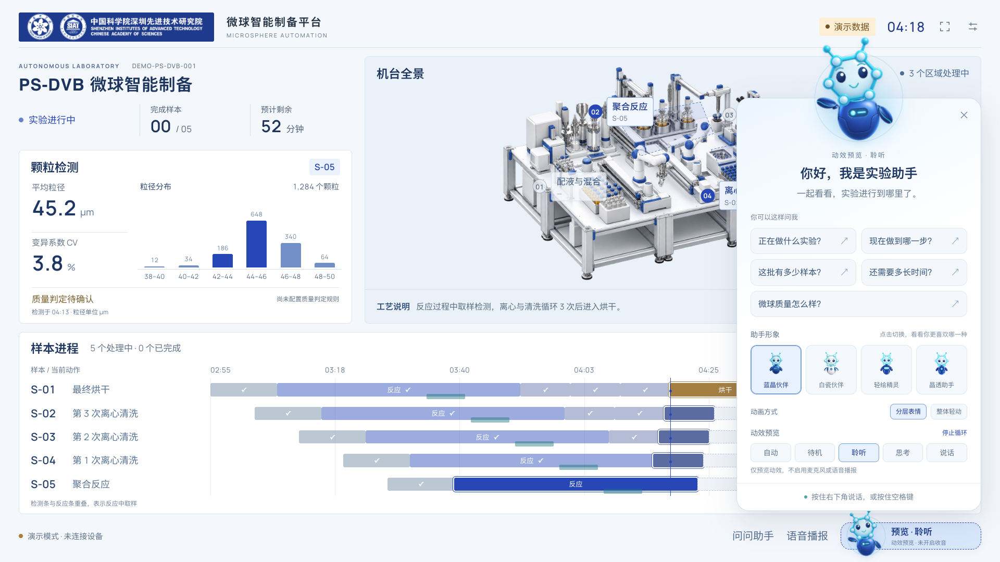

# 发布日志

## v2.1.0 · 实验助手形象与分层动效 · 2026-10-23

在现有大屏与实时语音字幕基础上，更新助手形象、欢迎卡片和状态反馈。界面、动效及文档已获用户确认，并已发布到线上演示。

### 变更

- 提供蓝晶伙伴、白瓷伙伴、轻绘精灵、晶透助手四款形象，保留共同的分子六边形创作概念，可在页面切换。
- 增加浮动欢迎卡片与五类实验问题入口，参考 WorkBuddy 对话框的呈现方式；回答沿用单行短暂字幕。
- 四款均支持头部、身体、双臂分层，加入眨眼、三种嘴型替换、侧头、点头及手臂动作。
- 支持待机、聆听、思考、说话四状态，提供“自动”、单状态预览、每三秒切换的循环演示，以及“分层表情 / 整体轻动”对比。
- 欢迎头像、语音入口与字幕头像同步；真实问答优先于预览。预览不启用麦克风或播报，减少动态效果设置下停止动画。

### 图文与检查记录

上图为本地演示页面实拍，使用模拟数据。分层动效对比、操作步骤和验收范围见 [本次版本升级说明](docs/版本升级说明-20261023.md)。

- 已完成类型检查、演示构建及浏览器交互检查，覆盖四款 × 四状态、眨眼、嘴型互斥、模式切换、减少动态效果和问答联动。
- 嘴型按说话状态循环，不与音素同步；本轮未操作真实麦克风、识别服务或设备链路。
- 整体轻动阶段的还原基线为本地提交 `17e3637`，本次提交包含分层实现、素材和文档。

## v2.0.0 · 实时语音字幕 · 2026-10-17

实验助手语音识别升级为流式实时转写：按住说话时字幕边说边出字，松开后即识别意图并回答。云端接入讯飞语音听写（流式版），未配置凭据时回退浏览器内置识别。

### 变更

- 新增讯飞语音听写（流式版）WebSocket 客户端：HMAC 鉴权地址生成、麦克风 16k 单声道采样分帧上行、动态修正结果拼装，识别中间结果实时刷新到字幕区。
- 浏览器内置识别回退路径同步开启中间结果，无云端凭据时仍保留实时字幕。
- 凭据通过 `app/.env.local` 的 `VITE_XFYUN_APP_ID` / `VITE_XFYUN_API_KEY` / `VITE_XFYUN_API_SECRET` 配置（不提交仓库），现场可用 localStorage 的 `voice.xfyun` 键临时覆盖，无需重新构建。
- 新增听写分片重组与鉴权签名单元测试；类型检查、生产构建及真实服务端到端冒烟验证通过。

## v1.0.0 · 首版前端预览 · 2026-10-02

面向 SIAT 微球实验室，提供独立实验展示大屏与统一蓝白主题操作台。首版提供 GitHub Pages 在线演示，截图及公开站点均采用模拟数据。真实设备仍待联调。

### 展示与交互

- 实验全景大屏：实验概览、活动区域与样本标签、颗粒检测结果同屏呈现。
- 多样本进程：支持同一流程下 1–10 个样本错峰并行，展示反应内检测、三次清洗与烘干阶段。
- 两种演示布局：默认信息布局与右侧机台全景布局，共享样本数量、运行状态和模拟进度。
- 实验助手：五类状态查询，提供主动触发的语音识别、播报、文字回答和相关区域提示。
- 统一视觉：官方 SIAT 品牌标识、重制机台示意、本地字体，以及蓝白主题的登录与操作页面。

### 实验操作台

- 首页展示设备状态、运行任务、颗粒统计、实验结果与运行日志。
- 保留实验流程列表、可视化节点编排、试剂与耗材管理、模块调试、参数配置和实验记录等原业务入口。
- 提供开发预览数据，覆盖设备概览、实验列表与画布、试剂、耗材及模块库；所有保存与设备指令仍被阻止。

- 提供 GitHub Pages 自动部署，公开构建强制使用模拟数据，禁用 MQTT、保存与设备指令。

### 工程与资料

- 沿用原 Vue 3 / TypeScript 工程与业务接口，增加独立展示路由和完整快照适配器。
- 区分实时、缓存、失效和演示数据，校验批次、序号与样本关联，缺少质量规则时不自动判定。
- 归档原始资料、需求依据、官方品牌来源和视觉资产记录；提供图文 README、本地预览入口与数据接入契约。

### 验证与交付状态

- 本地验证包括类型检查、生产构建、状态与问答测试，以及带模拟数据的浏览器页面检查。
- 真实设备与后端快照、现场语音链路、机台区域校准、实屏观看和持续运行仍待联调验收。
