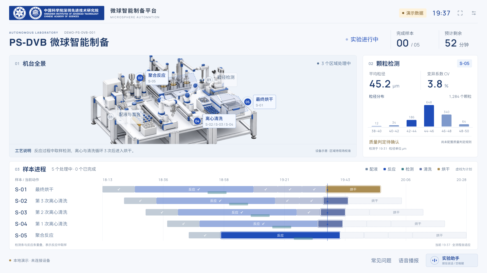
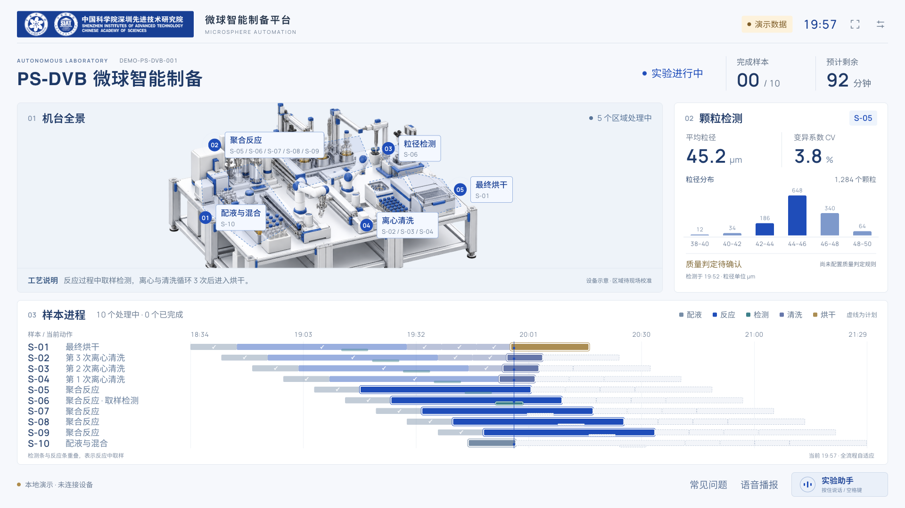
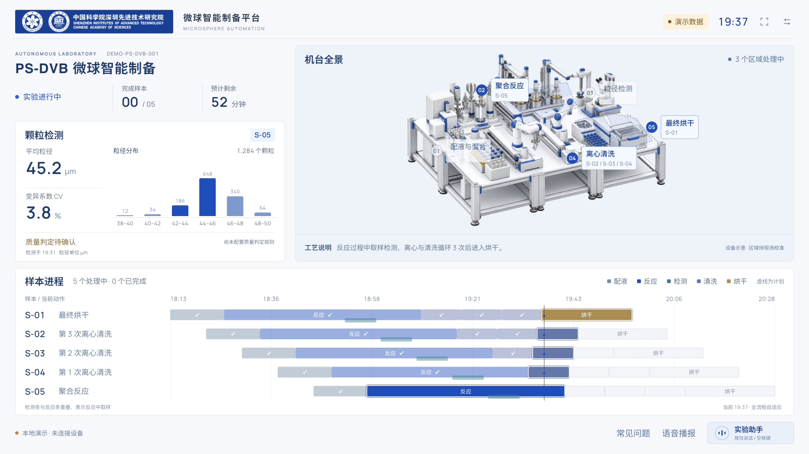
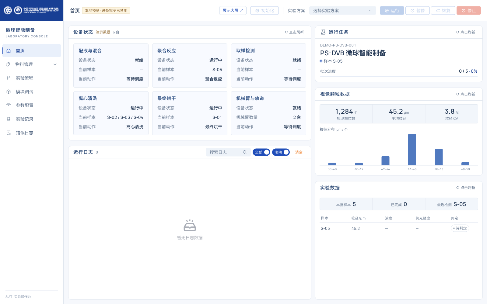
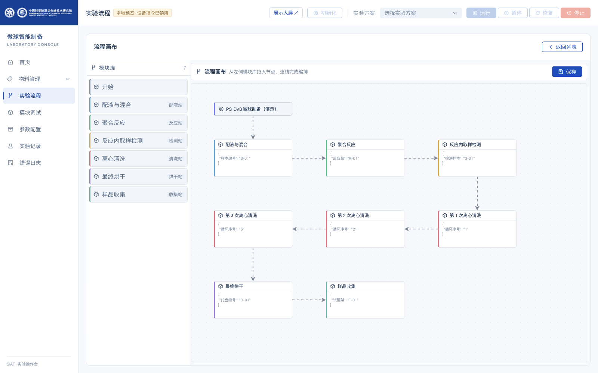
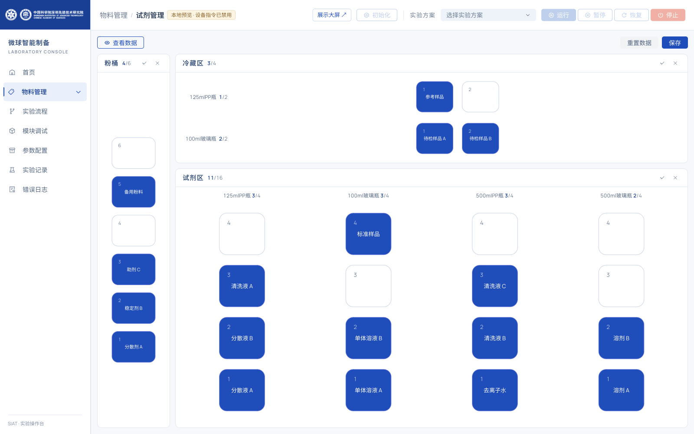
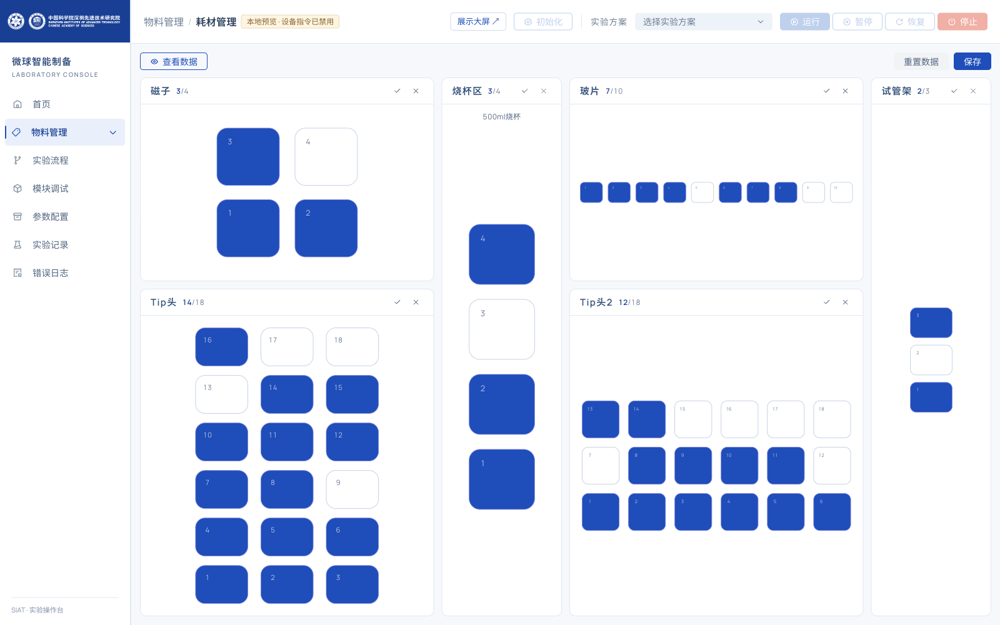
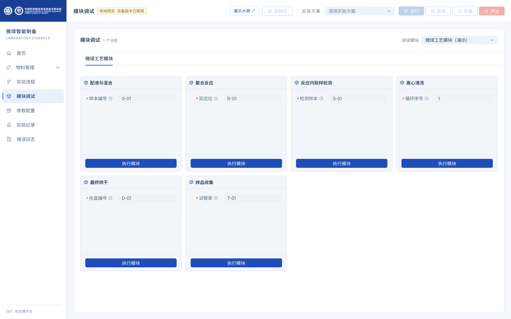

# 微球智能制备平台

面向中国科学院深圳先进技术研究院（SIAT）微球实验室的自动化展示与操作界面。平台提供面向参观者的实验展示大屏，以及面向操作人员的实验控制台，让机台活动、样本进程和颗粒检测结果清晰可见。

首版采用明亮蓝白主题、官方 SIAT 品牌标识和重新制作的机台视觉，基于现有 Vue 工程实现，适配实验室大屏展示与电脑端日常操作两种场景。

> 本文展示首版前端特性。所有截图均来自本地运行页面，使用明确标记的模拟数据；真实设备、后端快照与现场语音链路仍待联调。公开站点固定运行演示模式。



[在线演示](https://techfanseric.github.io/weiqiu/) · [操作台演示](https://techfanseric.github.io/weiqiu/#/) · [GitHub 仓库](https://github.com/techfanseric/weiqiu)

## 核心特性

| 能力 | 内容 |
| --- | --- |
| 实验全景展示 | 实验名称、运行状态、机台活动区域、完成样本和预计剩余时间集中呈现 |
| 多样本并行追踪 | 支持同一实验流程下 1–10 个样本错峰运行，清晰区分当前动作与计划阶段 |
| 颗粒检测可视化 | 展示平均粒径、变异系数 CV、颗粒数量和分布，并关联样本及检测时间 |
| 实验操作台 | 统一呈现设备状态、运行任务、物料、流程、模块调试及实验记录入口 |
| 实验状态问答 | 围绕当前实验、步骤、数量、剩余时间和质量，提供语音及文字反馈 |
| 独立演示环境 | 无需连接设备即可浏览大屏和带示例数据的操作页面 |

## 实验展示大屏

以 1920 × 1080 为设计基准，面向约 55 寸实验室展示屏。大屏独立于操作台，持续呈现实验状态，不显示操作工具条和工程日志，便于参观讲解。

机台示意按配液与混合、聚合反应、粒径检测、离心清洗和最终烘干分区。活动区域与样本标签联动，同一时刻可以看到多个区域共同工作。检测区呈现当前样本的粒径统计；没有检测结果或质量规则时，明确显示待检测或待判定。

### 多样本并行进程

每个样本独占一行，共用完整时间轴。反应内取样检测以重叠阶段表示，三次离心清洗分别呈现；进行中、已完成与计划阶段使用不同的视觉状态，行头始终显示样本编号和当前动作。

下图展示十个样本同时处于不同工艺阶段：部分样本正在清洗或烘干，部分仍在反应，还有样本进入配液阶段。观看者可同时了解单个样本的进度与整批实验的节奏。



### 两种展示布局

默认布局以机台在左、检测在右组织信息；全景布局把机台放在右侧，并跨越实验概览行，让矩形机台拥有更完整的展示空间。左侧集中放置实验概览和检测结果，底部时间线保持通栏。



在「演示设置」中可切换布局、样本数量、运行状态与模拟进度。两种布局共享当前演示场景；全景布局目前作为演示选项提供，正式数据模式使用默认布局。

## 蓝白主题实验操作台

操作台面向实验准备、流程编排和设备管理。侧栏、工作区、表单、按钮、图表与节点画布采用一致的蓝白视觉体系，保留原工程的业务入口和操作链路。

### 设备与实验概览

首页集中展示设备状态、当前任务、颗粒数据和实验结果。设备卡片提供当前样本与动作，检测信息同时给出统计指标和分布图；运行日志单独保留在操作端。



### 可视化流程编排

通过实验流程列表进入节点画布，从模块库选择工艺模块，查看节点参数与执行关系。模块库和节点使用一致的来源标识，帮助操作人员理解从配液、反应、检测到清洗、烘干和收集的工艺结构。

下图为填充了示例模块和节点参数的本地流程画布，仅用于展示界面，不是可直接执行的实机工艺配方。



### 试剂与耗材管理

试剂管理按粉桶、冷藏区和试剂区组织位置，结合容器类型、物料名称与区域数量查看上料情况。示例页面同时包含已放置和空闲位置，便于了解区域分布。



耗材管理覆盖磁子、Tip 头、烧杯、玻片和试管架等区域，以槽位状态和数量概览呈现准备情况。



### 模块与参数界面

模块调试按分组呈现工艺模块及其输入字段，与流程编排中的模块定义对应。下图展示六个模拟模块及示例输入；本地预览中所有保存和设备指令均被阻止。



## 实验状态问答

实验助手围绕五类问题读取当前实验快照：正在做什么实验、做到哪一步、有多少样本、还需要多长时间、检测质量如何。可通过常见问题按钮查询，或在浏览器支持时按住说话按钮 / 空格键触发识别，回答以语音和文字反馈，并突出相关信息区域。

状态问答只解释当前实验，不下发设备控制指令。质量回答以实际检测数据和已配置规则为依据，信息不足时明确说明，不自动推断合格。

## 品牌与视觉资产

官方 SIAT Logo 保持原始比例，配色依据官网资产与样式整理；机台视觉重新制作，原始机械图、设备图片和 PPT 仅用作结构参考。字体本地托管，页面运行不依赖外部字体服务。

机台图用于展示说明，区域位置和内部细节仍需现场核准。品牌来源见 [视觉与素材规范](docs/视觉与素材规范.md)，设备图和字体来源见 [视觉资产记录](materials/generated/README.md)。

## 本地体验

建议 Node.js 24。从仓库根目录执行：

```sh
cd app
npm ci --ignore-scripts --no-audit --no-fund
npm run dev -- --host 127.0.0.1 --port 9006
```

| 入口 | 内容 |
| --- | --- |
| [默认大屏](http://127.0.0.1:9006/#/display?mode=demo) | 五样本演示 |
| [十样本并行进程](http://127.0.0.1:9006/#/display?mode=demo&samples=10) | 多阶段并行展示 |
| [全景布局](http://127.0.0.1:9006/#/display?mode=demo&layout=machine-right) | 机台位于右侧 |
| [操作台首页](http://127.0.0.1:9006/?preview=1#/) | 设备与实验概览 |
| [实验流程](http://127.0.0.1:9006/?preview=1#/experiment) | 示例列表与节点画布 |
| [试剂管理](http://127.0.0.1:9006/?preview=1#/material/sample) | 带名称的模拟物料 |
| [耗材管理](http://127.0.0.1:9006/?preview=1#/material/consumable) | 模拟槽位占用 |
| [模块调试](http://127.0.0.1:9006/?preview=1#/module) | 示例模块及输入字段 |

本地开发时，大屏的 `mode=demo` 不连接 MQTT 或设备；操作台的 `?preview=1` 位于 `#` 之前，启用模拟读取并阻止保存和设备控制。GitHub Pages 使用独立的 `npm run build:demo` 构建，所有页面强制使用模拟数据，不受 URL 参数影响。普通 `npm run build` 仍保留正式登录与接口行为。

## 技术与接入

沿用 Vue 3、TypeScript、Vite、Arco Design Vue、AntV X6、ECharts 和 MQTT。应用位于 `app/`，正式展示入口为 `#/display`，保留登录校验。

展示端提供完整快照适配与校验，检查批次、序号、样本关联和数据时效；缓存与失效数据有明确状态，不自动替换成演示值。新增快照协议需要后端确认和实现，可通过 MQTT 或可选的同源快照接口接入。详见 [展示数据契约](docs/展示数据契约-v1.md) 和 [环境变量说明](app/.env.example)。

在 `app/` 下验证：

```sh
npm run typecheck
npm test
npm run build
```

现场交付还需完成真实流程与站号映射、设备控制回归、数据重连恢复、麦克风与扬声器联调，以及 55 寸实屏和持续运行验收。

## 发布部署

推送 `main` 后，GitHub Actions 自动执行类型检查、测试和演示构建，再发布到 GitHub Pages。工作流见 [.github/workflows/pages.yml](.github/workflows/pages.yml)。公开演示不需要后端，也不能用于操作实机。

## 文档与目录

- [首版发布日志](CHANGELOG.md)
- [前端实施记录](docs/前端实施记录-20261002.md)
- [需求追踪表](docs/需求追踪表.md)
- [项目分析与实施方案](docs/项目分析与实施方案.md)
- [技术基线检查](docs/技术基线检查.md)
- [资料说明](materials/README.md)

```text
app/                           Vue 前端与开发预览数据
app/src/display/               独立展示大屏与状态模型
docs/                          需求、接入与实施文档
docs/screenshots/              发布介绍截图
materials/originals/           7 份用户原始资料（仅本地，不公开）
materials/brand/siat/           官方品牌资产与来源
materials/generated/           新视觉制作记录
materials/manifest.json        原始文件 SHA-256 校验信息（仅本地）
evidence/                      线上参考及技术基线记录
```

原系统参考：[微球演示系统](https://platform-demo.iot.hitbot.cc/weiqiu/#/)。公开仓库从脱敏首版提交开始，包含前端、文档、品牌资产与重制视觉。原始资料、线上采集记录、环境配置及公开前历史只保留在本机。原硬编码连接凭据已移除，实机接入需由登录会话提供短期 MQTT 连接凭据。
