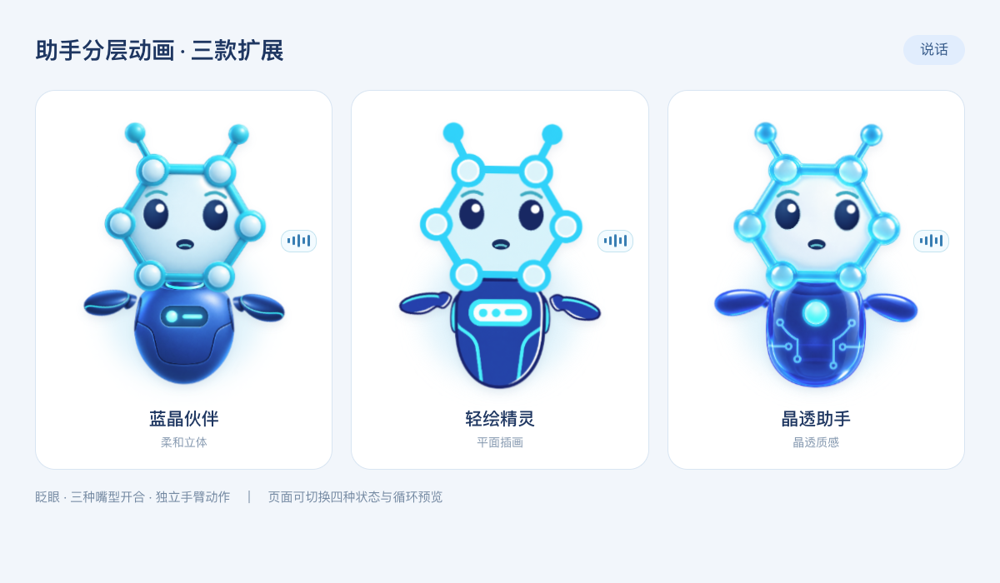
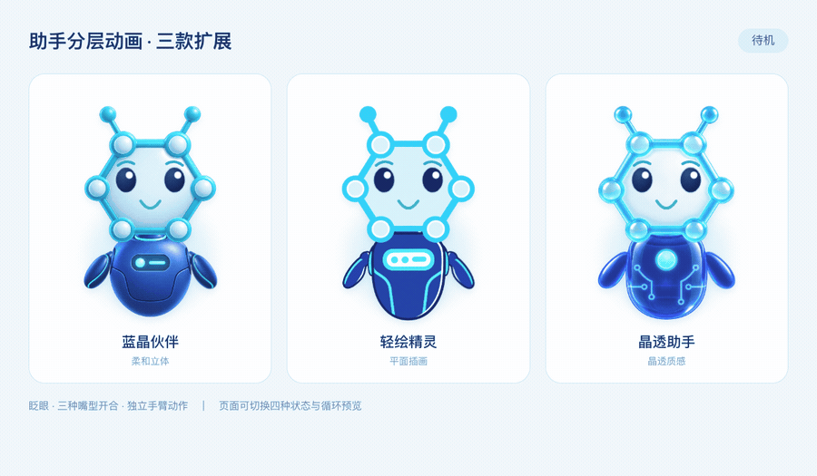
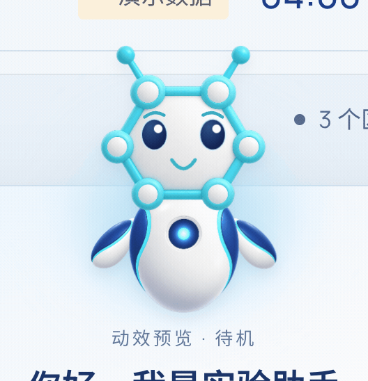

# 实验助手形象与分层动效升级

**v2.1.0 · 2026-10-23 · 本地验收通过**

本次在现有展示大屏与实时语音字幕上升级助手的视觉和交互反馈。四款形象沿用分子六边形头部、节点与短触角的共同概念，参考 WorkBuddy 对话框的呈现方式，融入蓝白实验界面。

## 01 · 页面效果

*实际本地页面截图，使用明确标注的演示数据。右侧欢迎卡片提供五类实验问题、四款形象、动画方式与状态预览；图中为聆听预览。*

点击右下角“问问助手”打开卡片。问答仍围绕当前实验、当前步骤、样本数量、预计剩余时间和检测质量；回答继续使用机台下方的短暂单行字幕与语音反馈。

## 02 · 四款形象，一套动作方案

| 形象 | 视觉特点 | 本次完成 |
| --- | --- | --- |
| 蓝晶伙伴 | 柔和立体蓝色材质 | 头身双臂分层、眨眼、嘴型替换与四状态 |
| 白瓷伙伴 | 白瓷质感、蓝色细节 | 首先落地的分层方案，保留供统一对比 |
| 轻绘精灵 | 轻量插画轮廓与平面配色 | 复用动作方案，按形象校准部件与五官位置 |
| 晶透助手 | 玻璃质感与电路细节 | 复用动作方案，保留通透材质特征 |

*三款扩展形象的说话状态对比：将实际页面组件放入并排画布，展示材质、部件和表情，并非大屏页面截图。白瓷伙伴的动态示例见下文。*

### 动态预览

*并排组件动效预览：待机 → 聆听 → 思考 → 说话。GIF 仅用于文档展示，页面动画由图层、表情与 CSS 驱动。*

展开查看白瓷伙伴的四状态动效

*白瓷伙伴在实际页面中的局部动效录制。*

## 03 · 四种状态如何反馈

| 状态 | 眼睛与嘴巴 | 头部与手臂 | 状态提示 |
| --- | --- | --- | --- |
| 待机 | 自然眨眼、静态微笑 | 轻微呼吸与手臂摆动 | 柔和光晕 |
| 聆听 | 眨眼、专注表情 | 侧头并抬起一侧手臂 | 扩散声波 |
| 思考 | 视线上移 | 轻摆，手臂靠近下巴 | 环绕光点 |
| 说话 | 三种嘴型交替开合 | 小幅点头、双臂交替摆动 | 五段律动条 |

“分层表情”为默认方式；“整体轻动”保留上一阶段的整图动效，方便直接比较。欢迎头像、右下语音入口与字幕头像使用同一款式及当前状态。

嘴型依据“说话”状态循环，尚未与语音音素或音量同步。系统启用减少动态效果时停止动画，保留状态文字和静态图形。

## 04 · 页面切换与演示

1. 打开大屏，点击右下角“问问助手”。
2. 在“助手形象”中选择四款中的任意一款。
3. 选择“分层表情”或“整体轻动”。
4. 点击“待机 / 聆听 / 思考 / 说话”预览单状态，或点击“循环演示”每三秒切换。
5. 点击“自动”或停止循环，恢复问答状态驱动；真实提问、按住说话或收起卡片也会退出预览。

**动效预览不启用麦克风或语音播报。** 预览期间有明确标签；真实问答优先，避免把演示状态误认为正在录音。

启动本地服务后，可打开 [白瓷伙伴预览](http://127.0.0.1:9006/#/display?mode=demo&layout=machine-right&assistant=ceramic)。链接参数 `assistant=classic|ceramic|illustrated|glass` 选择形象，`assistantMotion=whole` 选择整体轻动，省略动画参数则使用分层表情；旧白瓷参数 `ceramicMotion=whole` 继续兼容。

## 05 · 验收与交付记录

本轮界面与动效已获用户验收通过。此前已完成的实现检查记录如下，本次文档整理未重新执行应用测试：

- 类型检查、演示构建通过；浏览器覆盖四款 × 四状态共 16 种组合。
- 检查眨眼开合、每个采样时刻仅一种嘴型可见，以及各款式的部件来源与状态同步。
- 检查分层 / 整体切换、URL 刷新保留、旧白瓷链接兼容和减少动态效果设置。
- 通过快捷问题检查问答联动，确认清除预览状态、语音入口与字幕进入所选形象的说话状态。

本轮未操作真实麦克风、语音识别服务或设备链路；现场联调事项继续按原交付计划跟踪。

整体轻动阶段已保存本地还原基线 `17e3637`。本次提交包含分层实现、素材与文档；线上演示尚未发布 v2.1.0。

## 历次更新与相关记录

- [发布日志：v2.1.0、v2.0.0 与 v1.0.0](../CHANGELOG.md)
- **v2.0.0 · 2026-10-17：实时语音字幕**，原更新内容完整保留于发布日志。
- **v1.0.0 · 2026-10-02：首版前端预览**，[原实施记录](前端实施记录-20261002.md)及平台截图继续保留。
- [助手动效实现说明](助手动效说明-20261023.md)
- [四款原始创作方案](../materials/generated/lab-assistant-variants.md)
- [白瓷分层制作记录](../materials/generated/ceramic-layered-v1.md)
- [其他三款分层制作记录与检查结果](../materials/generated/assistant-layered-all.md)

四款助手是本项目创作形象，不是 SIAT 官方吉祥物。生成素材与官方品牌资产分开管理，Logo 继续使用官方原件。
