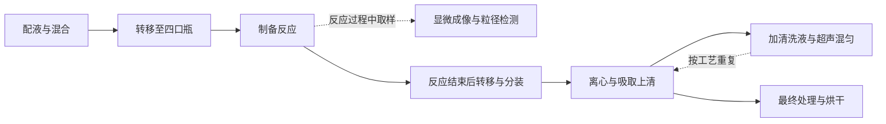
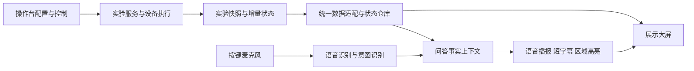

# 微球项目分析与实施方案

分析日期：2026 年 10 月 2 日。仓库：`~/weiqiu`。

建议沿用现有 Vue 前端，按“独立展示大屏、操作台视觉统一、语音状态问答”三部分推进。第一步先把样本、工艺步骤和机台区域对应起来，再制作画面和接入真实数据。现有机台图用于核对结构和布局，正式页面中的机台及模块视觉重新制作，统一视角、光照与材质；第一版仍可采用分层静态图配合动效，无需完整网页 3D 仿真。

本分析以沟通逐字稿及用户 10 月 2 日补充要求为需求依据，结合 22 页设备方案、机械总图、素材图、软件录屏、源码和线上系统。用户已明确：原始设备素材只作参考，正式页面视觉重新制作；品牌素材由实施方自行通过 ego 浏览器核实取得。下文的工期、布局、数据契约及技术拆分均是实施建议；现场流程、接口完备程度和最终屏幕条件尚未确认。

## 要解决的业务问题

参观者站在设备旁 2–3 米处，只能看到机械臂和装置运动，不知道哪个样本正在做什么、为什么要做这一步、结果如何。现有首页主要是设备参数、运行日志和数据表，操作人员能理解，外行需要讲解者补充大量解释。大屏应把这些信息组织成能与实机动作对应的实验故事。

操作人员仍在电脑上配置试剂、耗材、实验流程和运行控制。沟通中明确表示现有操作逻辑基本可用，因此该部分优先做明亮蓝白主题和细节整理，保持业务习惯。大屏与操作台共享实验事实，不同步页面导航。

PPT 标题是 PS-DVB 微球智能化制备机器平台。结合第 3 页工艺图以及第 9、13、14、17–21 页模块说明，业务可概括为配液、混合、转移、反应、粒径检测，以及反应后的分装、离心清洗、混匀和烘干。粒径检测是对参观者有解释价值的重点结果，但并不是完整制备工艺的唯一环节。

图为依据 PPT 整理的业务概览，不是可执行流程。检测可以发生在反应过程中，清洗包含循环，不能把所有步骤画成只走一次的串行进度条。每个样本的实际步骤顺序及分支，应来自现场流程导出。

## 本次确认的范围

| 部分 | 要做什么 | 首期边界 |
| --- | --- | --- |
| 展示大屏 | 设备区域、当前实验与样本、并行时间线、颗粒统计、实验结果、问答反馈 | 独立页面、固定一屏，约 55 寸；不放工程日志、配置表单和运行控制 |
| 现有操作台 | 蓝白主题、统一字体与间距、表单表格、流程画布、弹窗等视觉整理 | 保留原菜单和业务流程，避免将 UI 改造变成后台重做 |
| 语音问答 | 按键触发、受限意图、语音播报、短暂字幕和区域高亮 | 围绕当前实验事实；麦克风和语音服务是外部依赖 |
| 数据联动 | 同一实验的一份状态，驱动大屏、图表与回答 | 必须区分实时、缓存、演示和未知；联调能力尚待验证 |

完整 1:1 数字孪生、机器人运动仿真、同时执行不同流程、自由聊天、语音下发实验控制、手机端全面改版，均不应默认为本次交付项。后续若增加，应单独估算。

逐条依据见仓库中的 `docs/需求追踪表.md`，尤其是沟通 21:48–25:22 的双端边界、25:37–32:51 的并行甘特图要求，以及 33:07–36:59 的语音交互结论。

## 现有资料和系统能支持到什么程度

**可以开始设计和前端开发。** 已有原始前端、机台顶视与透视图、各模块图片、业务工艺图和软件录屏。源码具备 Vue 3、Arco、ECharts、X6 流程编辑、MQTT 接入和基础甘特图组件，没必要另换技术栈。

**真实联动还不能判定完成。** 线上已登录查看首页、实验流程、模块调试、试剂、耗材与实验记录。首页可见的 8 台设备以及 `TASK-000089-11`、45.2 μm 等值与源码示例一致；源码在没有收到数据时也会回退示例并产生当前更新时间。由此可确定：仅凭当前画面无法证明数据来自实机。未对服务器或设备端进行验证。

线上实验列表有 8 项，包含工程菌株、一人奶茶店等其他演示流程，本次未在列表中看到可确认的微球现场流程。附带 MP4 约 48.9 秒，主要展示流程编辑和物料界面；尚缺真实执行过程的机台实拍、现场流程导出和对应状态消息样例。

**设备命名需要校准。** 线上示例包含 PCR 温控模块等名称，而设备方案介绍的是粉末加样、四口瓶反应、粒径检测、油浴、分装、离心等模块。不能拿示例里的 8 台设备直接给机械图标注。PPT 耗材数量、线上槽位数量也有差异，必须先建立实机区域表。

Windows `.exe` 已原样归档但未执行，其内容不能直接视为可加载的 GLB 或 STEP 模型。现有 PNG 和用户附带的白色效果图只作结构、布局及风格参考，不直接用作页面素材。应制作新的机台总览与模块分层图，核对机械细节和区域定位；需要模型支持时再索取合适的机械导出格式。

## 大屏怎么设计

建议先按 1920 × 1080、16:9 制作设计基准，并测试 4K 同比例显示；这是假设，最终以现场电视、连接方式和系统缩放为准。字体需在 55 寸实屏的 2–3 米处验证，建议关键动作和样本信息以 24–32px 为起点，主要数字进一步放大。

版式使用三层信息：顶部给出实验名、总状态、已完成/总样本和预计剩余；中部以机台图为主，旁边展示粒径结果和当前检测样本；下部保留足够空间给 1–10 行并行甘特图。语音字幕使用预留短条或不遮挡关键内容的局部浮层，说完后消退。

| 区域 | 观众需要读到的信息 | 呈现方式 |
| --- | --- | --- |
| 实验概览 | 在做什么实验、运行或暂停、已经完成多少 | 简明中文名称和少量大数字；总数必须明确是批次总量还是并发量 |
| 机台示意 | 哪个区域在执行什么动作，服务哪个样本 | 依据真实结构重新制作的机台与模块图、区域轮廓高亮、样本编号与当前动作；不只变色 |
| 并行甘特图 | 每个样本的当前阶段、已完成阶段、预计后续 | 一样本一行，公共时间轴；进行中突出，已完成弱化，计划部分虚化 |
| 颗粒与结果 | 当前检测对象、粒径分布、关键质量结果 | 显示样本 ID 和检测时间，2–4 项关键指标及分布图；指标口径待确认 |
| 助手反馈 | 听到了什么、现在回答哪个问题 | 小型状态动画、短字幕、相关区域高亮；不展示聊天记录 |

机台层使用重新制作的分层渲染图或 SVG 模块图，再叠加独立状态区域。先完成总览和典型模块风格样张，再批量制作；原始 CAD 截图、PPT 图和白色效果图不直接用于正式页面，也不以简单去底调色代替重制。区域配置以新资产为准保存为归一化坐标，使不同分辨率下仍能对齐。动效仅表示状态：反应区柔和脉动、当前检测区域扫光、搬运路径短暂强调。除非有真实轨迹数据，不模拟机械臂精确姿态。

机器总览应一直保留多个活动区域。语音回答某个样本时可以提高其视觉权重，但不能把其他样本的并行状态隐去。为防止短步骤在长时间轴中消失，需把工程动作映射到经确认的业务阶段，行头同时常驻“样本编号 + 当前动作”，不能依赖悬停提示。

品牌已通过官网核实为中国科学院深圳先进技术研究院（SIAT），官方院徽与中英文组合文件归档于 `materials/brand/siat/`。建议以 Logo 采样深蓝 `#014099`、官网交互蓝 `#014EC0` 和白色/浅灰蓝建立本项目的明亮主题。这是官网资产与样式的设计依据，不是已核验的正式 VI 标准。来源、版本用途和制作原则详见 `docs/视觉与素材规范.md`。

## 工程上怎么接

建议在现有应用内增加不经过操作台布局的 `#/display` 路由，展示布局与原 `layout` 分开，数据适配层共享。仅增加路由还不够：`App.vue` 当前全局连接 MQTT、处理设备弹窗并固定暗色主题，需要将展示端与操作端的主题、通知方式和连接权限拆清楚。

这是建议的逻辑结构，不代表现有后端已经提供全部接口。应优先复用既有 HTTP 和 MQTT，再补充首屏快照、样本步骤时间和区域映射等缺口。

### 先统一数据对象

现有 `DashboardPayload` 覆盖设备、单一运行任务、视觉指标和实验结果，但没有完整表达多样本并行步骤、区域关联、计划与实际时间、断线与数据来源。另有 `/hitbot/lide/plate/status/` 样本通道，需要确认微球现场是否使用。建议增加下列模型，由适配器兼容旧字段。

| 对象 | 建议字段 | 原因 |
| --- | --- | --- |
| 消息范围 | `schemaVersion, runId, flowId, flowVersion, sequence, serverTime` | 区分批次与流程版本，防止乱序和旧数据覆盖新实验 |
| 数据质量 | `source, receivedAt, lastEventAt, connectionState` | 区分 live、replay、demo；缓存有时间戳，离线不能伪装运行中 |
| 实验 | `status, startedAt, completedCount, totalCount, estimatedEndAt` | 一致地显示运行、暂停、完成及剩余时间 |
| 样本 | `sampleId, sampleLabel, status, currentStepIds, steps[]` | 同一流程错峰并行，允许反应与取样检测等关联动作 |
| 步骤实例 | `stepInstanceId, stageId, occurrence, moduleIds, status, plannedStartAt, plannedEndAt, actualStartAt, actualEndAt` | 清洗重复三次等场景不能只靠步骤名去重；不把计划当已执行 |
| 设备模块 | `moduleId, displayName, regionId, status, activeSampleIds` | 将后端站号、机台区域与样本关联；支持一个区域多个活动样本 |
| 检测结果 | `runId, sampleId, measuredAt, metrics, distribution, qualityRuleVersion, result` | 防止把上一样本结果说成当前样本，保留判定规则来源 |
| 语音上下文 | `requestId, runId, snapshotSequence, intent, targetIds` | 回答对应同一时刻的数据，实验切换后取消旧回答 |

字段名是建议契约，需和原团队核对实际消息。现有协议中的 `devcie-status` 和 `finshed` 有拼写遗留，适配器应兼容，不应直接改单边导致断联。快照与增量数据必须带实验范围；更换批次时清空上一批次的图表与结果，不能沿用现有简单浅合并。

### 首屏与实时更新

大屏打开时先取当前实验完整快照，再订阅增量；连接恢复后重新校准快照和服务器时间。页面动画可以平滑过渡，但步骤完成与质量判定只由有效数据推动。心跳证明连接正常，不等于业务数据刚刚更新。

`localStorage` 可用于短暂恢复画面，不能承担跨电脑、跨浏览器同步。操作台和电视端必须订阅同一实验。若只是同电脑的第二个浏览器窗口，可额外优化消息同步，但后端仍应作为最终事实来源。

预计剩余时间最好由调度端提供。只有计划时间时标注“预计”，暂停和资源等待需要修正预计结束时间。没有足够信息时显示“待估算”，不编造持续下降的倒计时。

大屏进入异常、断线、无实验或数据过期状态时，改变文案和动画，保留最后有效时间。正式模式禁止自动回退为“正常运行”的示例；演示模式应显式开启，并一直标示“演示数据”。

### 语音按五类问题实现

| 问题 | 读取事实 | 画面配合 |
| --- | --- | --- |
| 正在做什么实验 | 当前实验名称、状态 | 实验概览轻高亮 |
| 做到哪一步了 | 所有活动样本及其当前步骤 | 对应样本行和设备区域高亮；多样本时先概括再点明对象 |
| 有多少样本 | 批次总量、进行中、完成量 | 样本总览与时间线计数 |
| 还剩多久 | 已确认的预计结束时间或剩余估计 | 时间信息高亮，播报包含“预计” |
| 质量怎么样 | 指定样本的检测时间、粒径指标和判定 | 颗粒图表与结果面板高亮 |

首期可采用“意图分类 + 结构化事实 + 模板回答”，无需开放式智能体。即使使用语言模型，也限制其只能读取已允许的数据字段。没有检测数据时明确回答尚未检测，不根据图表外观臆测合格。

交互状态至少包括待机、收音、识别、生成回答、播报和失败。按键触发从控制端或现场确定的输入设备进入；不要求观众在电视上操作。失声、识别失败时回到待机并给简短反馈。字幕保留当前句或最近数秒，说完自动消失。静音仍可阅读字幕。

语音 API、麦克风按键/HID 映射、收音电脑、扬声器、浏览器录音权限和播报启动条件必须在真实现场链路上确认。此前可以用明确标注的文字问题和模拟事件完成界面联动验收。

## 现有代码的复用和改造位置

| 文件或目录 | 建议改动 |
| --- | --- |
| `app/src/router/index.ts` | 新增独立大屏路由和展示布局；确定展示端会话策略 |
| `app/src/App.vue` | 拆出全局暗色设置、MQTT 状态订阅及弹窗行为，避免展示页继承操作弹窗 |
| `app/src/assets/main.less` | 建立蓝白主题变量；同步 Arco、图表、流程画布与自定义组件颜色 |
| `app/src/hooks/dashboard.ts` | 分离演示与生产数据，加入来源、时效、批次清理和多样本适配 |
| `app/src/hooks/main.ts`、`app/src/mqtt/` | 接入样本/设备增量与连接状态，兼容旧协议并处理重连 |
| `app/src/components/z-gantt/` | 复用比例计算思想，补当前时间指示、多状态、自动适配与清空数据；重做大屏字号 |
| `app/src/views/home/components/` | 复用指标和分布数据，按大屏信息层级重新组织组件 |
| `app/src/views/flow/`、`app/src/module-x6/` | 保留编辑能力，检查浅色节点、连线、选中和禁用状态 |
| 建议新增 `display/`、`display-adapter/`、`voice/` | 放置独立页面、区域映射、统一数据模型和问答联动 |

现有甘特图组件没有挂到当前首页，且仅提供基础条形时间展示，不能将“已有组件”理解为“并行实验可视化已经完成”。详见技术基线中的具体问题。

## 实施顺序和工作量

先做可复用的状态样例和数据契约，再做页面。这样视觉稿能够覆盖真实的错峰、暂停、检测结果滞后和清洗循环，后续不会因接口语义不同返工。

| 阶段 | 交付物与完成条件 | 建议工作量 |
| --- | --- | --- |
| 1 业务和数据校准 | 真实流程清单；步骤、模块、机台区域映射；1/5/10 样本与异常状态样例 | 2–3 人日 |
| 2 双端视觉与素材制作 | 官网品牌依据；机台总览与典型模块样张；分层资产；双端页面及语音状态设计 | 4–6 人日 |
| 3 前端实现 | 展示路由、机台区域、并行时间线、图表、操作台主题、显式演示模式 | 5–7 人日 |
| 4 实时联调和验收 | 快照/增量、两端同步、暂停/恢复、断线/重连、批次切换、现场可读性 | 3–5 人日 |
| 5 真实语音接入 | 按键设备、识别与播报、五类问答、字幕和高亮联动 | 另加 3–5 人日 |

纳入机台与模块素材重新制作后，阶段 1–4 合计约 14–21 人日，语音全链路合计后约 17–26 人日。该估算以适合界面的分层静态图或简化轴测图为素材范围，完整精细 3D 建模另估。这是资料到位、既有后端提供主要状态、设计修改轮次可控前提下的初步工作量，不是交付日期承诺。接口新增、设备模型处理、麦克风硬件采购与现场排期另计。可先交付带模拟语音事件的界面，再在接口与设备就绪后完成真实语音验收。

建议首个里程碑是：一个白蓝大屏，在显式演示模式下完整回放 3 个样本错峰执行，机台区域、甘特图、检测结果和五类问答能正确对应；同时给出 10 样本满屏与断线状态。原团队认可业务映射后，再扩大操作台样式修改范围并联调。

## 验收要看什么

1. **视觉资产达标**：设备原图仅作参考，正式机台和模块图完成重制，视角、光照、材质及细节密度一致，区域映射经核对。官方 Logo 保持形状和比例，配色来源有记录。
2. **信息能读懂**：55 寸、2–3 米处，无鼠标操作可辨认实验名、运行状态、每个活动样本的当前动作和质量信息。用现场用户验证，不仅检查截图。
3. **并行表现正确**：1、5、10 样本，同一步骤的不同实例、短步骤、长反应、清洗循环、资源等待都能表达，当前高亮不互相覆盖。
4. **状态可信**：无实验、待检测、运行、暂停、完成、异常、断线和重连均有明确表现；演示值、缓存值与实时值不会混为一谈。
5. **两端一致**：在受控测试环境操作实验，收到服务端确认后大屏联动；同步时延可先以 2 秒内为联调目标，最终由现场消息频率确认。
6. **结果归属正确**：每次粒径和质量结果均能追溯到样本与检测时间，批次切换不残留上批结果；未提供合格判定规则时不自行创造阈值。
7. **语音可用**：五类问题对应真实事实；多人噪声环境通过按键触发；回答期间实验切换能取消旧回答；字幕不挡关键内容，结束后消退。
8. **原操作台无回归**：物料保存、流程编辑、运行控制、模块调试和记录等由原团队在测试环境回归；本次只读调研不执行这些动作。
9. **持续展示稳定**：建议按至少一个工作日运行验证，检查数据恢复、消息监听重复注册、内存增长和画面停滞；最终时长以现场使用要求为准。

## 需要原团队补齐的最小信息

| 信息 | 用途 | 缺失时能继续做的工作 |
| --- | --- | --- |
| 一份真实微球流程导出、步骤命名与模块 ID | 建立工艺阶段及区域映射，校正并行与循环 | 可先做布局及状态模型，不能签收真实高亮正确性 |
| 一段脱敏运行状态消息和检测结果，含时间与样本关联 | 明确 MQTT/HTTP 字段、顺序和时效 | 可用显式演示数据开发；不能声称实机已联通 |
| 实机槽位/区域确认和动作短视频 | 核对设备布局与动效含义 | 可依据现有顶视图制作新视觉，具体模块对应待校准 |
| 电视分辨率、缩放、双屏连接方式 | 确定字号、全屏和音频/麦克风所在设备 | 暂按 16:9 1080p 与 4K 适配 |
| 检测指标定义和合格判定来源 | 决定平均粒径、CV、圆度、浓度等保留项 | 暂用可配置指标，不硬编码质量阈值 |
| 五类问题的正式话术、语音服务与按键麦克风方案 | 完成现场语音链路 | 先实现交互状态和文本问题回放 |
| 若后续另有正式 VI 手册或指定标志版本 | 最终品牌版本校正 | 已取得官网 Logo 与配色依据，可直接开始设计，不等待客户另行提供 |

这些是后续联调与验收依赖，不影响当前立项完成，也无需等所有材料到齐才开始第一版设计。

## 本次已完成与验证限制

七份文件已归档并校验，源代码 111 个文件与原 zip 保持一致，UI 素材和 PPT 内嵌图已整理。已登录线上进行只读调研，保存截图与页面快照。依赖安装成功，`npm run build` 通过。`vue-tsc --noEmit` 发现 `src/hooks/user.ts` 第 36、45 行两处既有 TS2339：调用了未定义的 `api.user.get` 和 `api.roles.get`。

当前完成的是立项与分析，没有修改应用功能、部署新版、执行 Windows EXE、连接现场硬件或完成语音联调。原始文件、证据和技术基线均保留在本地仓库，便于接下来直接开展设计和实现。
